<div align="center">

# GuiOS · portfólio do Guilherme Carvalho

**Um portfólio em duas camadas: uma landing que qualquer pessoa entende em 30 segundos e, por
trás dela, um sistema operacional inteiro para quem quiser explorar.**

Recrutadores leem a página em `/`. Quem é da área entra em `/os` e encontra janelas arrastáveis,
dock, terminal de verdade, Safari e command palette. No celular, o sistema vira um smartphone.


**[guicmoreira.vercel.app](https://guicmoreira.vercel.app)** ·
[GuiOS](https://guicmoreira.vercel.app/os) ·
[Laboratório](https://guicmoreira.vercel.app/lab)

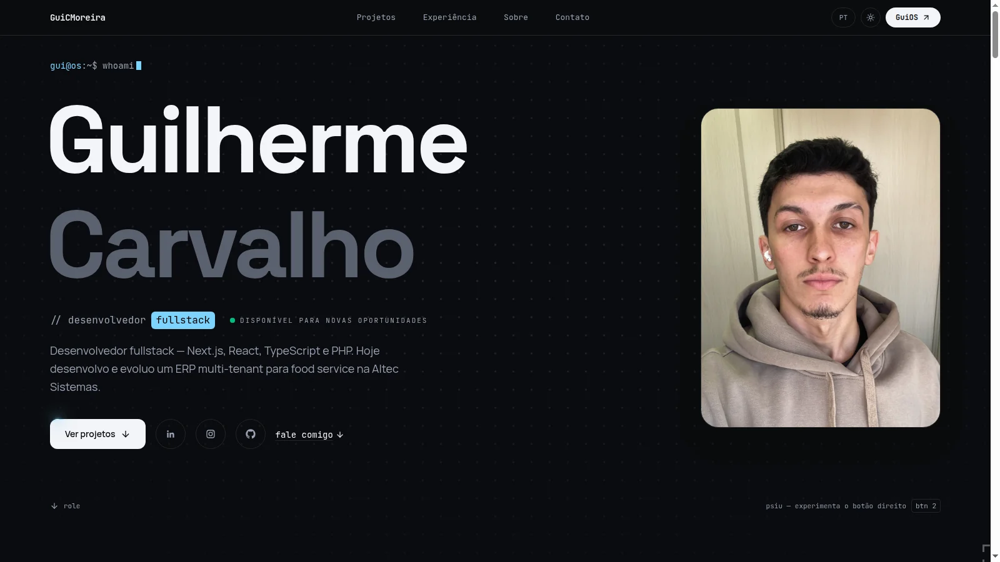

</div>

---

## Sumário

- [O problema](#o-problema)
- [O que ele faz](#o-que-ele-faz)
- [Telas](#telas)
- [Como funciona](#como-funciona)
- [Rodando localmente](#rodando-localmente)
- [Decisões que não são óbvias](#decisões-que-não-são-óbvias)
- [Testes](#testes)
- [Estrutura](#estrutura)
- [Como foi construído](#como-foi-construído)
- [Ainda não existe](#ainda-não-existe)
- [Créditos](#créditos)

---

## O problema

Portfólio de desenvolvedor costuma cair em um de dois extremos. Ou é uma página genérica com foto,
lista de tecnologias e três cards, que não mostra nada do que a pessoa sabe fazer; ou é uma
experiência tão criativa que o recrutador não acha o botão de contato e desiste.

A primeira versão deste projeto foi o segundo extremo: um sistema operacional parecido com o macOS,
em que cada seção era um app. Quem é da área gostava. Quem não é caía numa mesa vazia sem saber onde
clicar.

A versão atual separa os dois públicos sem abrir mão de nenhum:

- **`/` é a landing.** Conta quem é o Guilherme, o que ele construiu e como falar com ele, em
  linguagem simples, com o scroll fazendo o trabalho de apresentar cada parte.
- **`/os` é o GuiOS.** O mesmo conteúdo dentro de um sistema operacional, para quem quer ver
  do que o código é capaz. A própria landing mostra o GuiOS rodando dentro de um MacBook.
- **`/lab` é o laboratório.** Os efeitos foram testados ali, aprovados um a um e só depois
  entraram no site.

## O que ele faz

**Na landing (`/`)**

|                         |                                                                                                                                                       |
| ----------------------- | ----------------------------------------------------------------------------------------------------------------------------------------------------- |
| **Topo**                | Nome desenhado em TechText sobre uma grade de pontos que reage ao mouse, cargo que alterna (fullstack, web, PHP…), foto com tilt 3D e atalhos sociais |
| **Projetos**            | A tela trava e os seis projetos passam na horizontal, com contador e barra de progresso. Cada card abre um modal em duas colunas que nunca rola        |
| **GuiOS no MacBook**    | A tampa do notebook abre conforme o scroll, de fechada até ficar de pé, mostrando o GuiOS real rodando lá dentro                                      |
| **Ferramentas**         | Faixas de tecnologias que deslizam e aceleram com a velocidade do scroll, agrupadas em front-end, back-end e ferramentas                              |
| **Experiência**         | Cartões que empilham: Altec (trabalho), FATEC (formação) e projetos pessoais e estudos                                                                |
| **Sobre**               | Texto que acende palavra por palavra enquanto se lê                                                                                                   |
| **Contato**             | LinkedIn e Instagram em destaque e um formulário que pergunta o assunto e por onde a pessoa quer resposta                                             |
| **Detalhes de sistema** | Cursor de mira que trava nos alvos, faíscas no clique, menu próprio no botão direito, tema claro e escuro, português e inglês                          |

**No GuiOS (`/os`)**

| App              | O que faz                                                                                                                           |
| ---------------- | ----------------------------------------------------------------------------------------------------------------------------------- |
| **Projetos**     | Navegador estilo Finder com captura de cada projeto. O detalhe explica em linguagem simples o que é, que problema resolve e o que o Guilherme fez, e depois "por dentro", para quem é da área |
| **Sobre**        | App Notes com três notas: Sobre, Experiência (Altec, FATEC, projetos pessoais) e Stack & specs                                     |
| **Terminal**     | `help`, `whoami`, `ls projetos`, `open <projeto>`, `stack`, `carreira`, `neofetch`, `hire --me`, `matrix`, `coffee`, `guigle`…      |
| **Safari**       | Navegador com histórico; `github.com` mostra o perfil real, buscado na API pública do GitHub. Inclui o Guigle™, buscador paródia    |
| **Contato**      | LinkedIn, Instagram, GitHub e e-mail                                                                                                |
| **⌘K**           | Command palette para abrir apps, projetos e ações do sistema                                                                        |
| **Mesa**         | Cartão de apresentação, clima real de Bragança Paulista, lixeira com os bugs mortos durante o desenvolvimento, wallpapers e Ajustes |

**No laboratório (`/lab`)**

24 protótipos do [React Bits](https://reactbits.dev) rodando com o conteúdo e as cores do
portfólio, cada um com botão de aprovar. A lista aprovada virou a v5 da landing; o registro de onde
cada efeito entrou, e o que ele substituiu, está em
[`docs/specs/2026-10-16-landing-v5-combinacao.md`](docs/specs/2026-10-16-landing-v5-combinacao.md).

## Telas

| Projetos na horizontal                                                         | Modal do projeto                                                                    |
| ------------------------------------------------------------------------------ | ----------------------------------------------------------------------------------- |
| 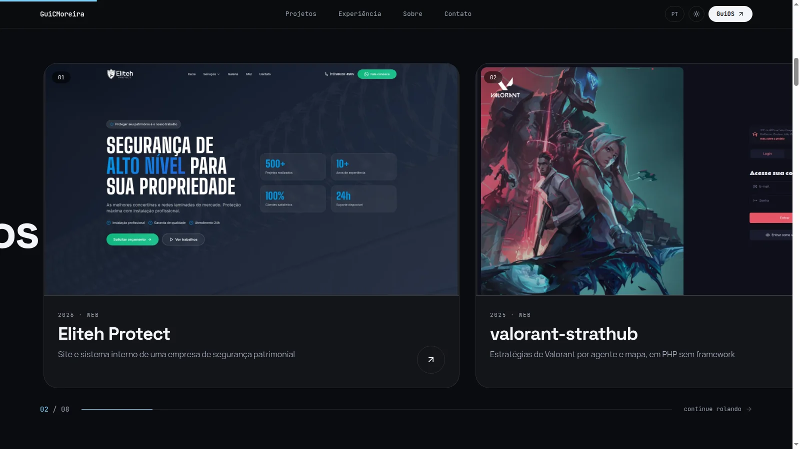 | 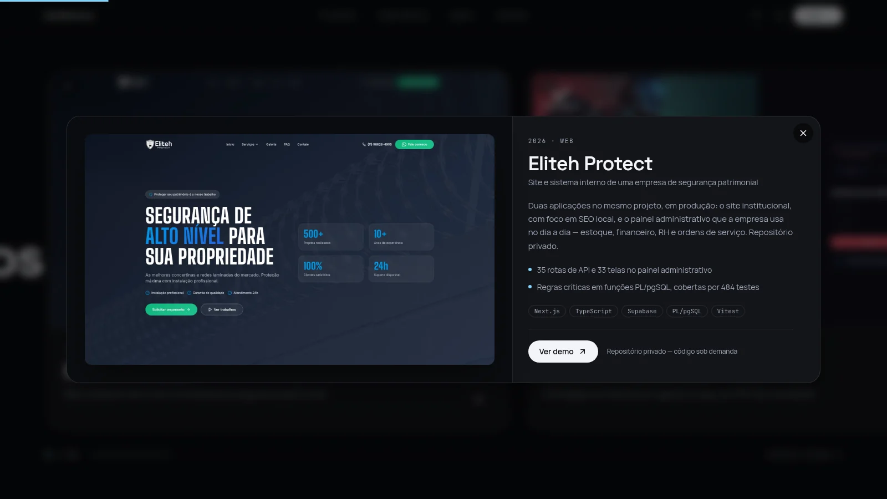 |

| GuiOS dentro do MacBook                                                                     | Experiência                                                                   |
| ------------------------------------------------------------------------------------------- | ----------------------------------------------------------------------------- |
| 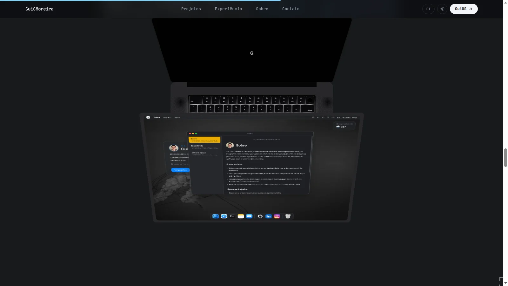 | 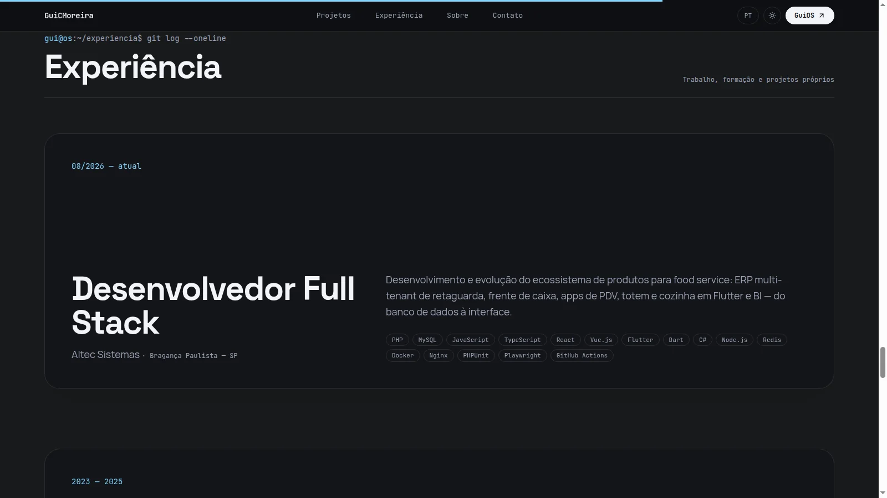 |

| Contato                                                                                   | Tema claro                                                          |
| ----------------------------------------------------------------------------------------- | ------------------------------------------------------------------- |
| 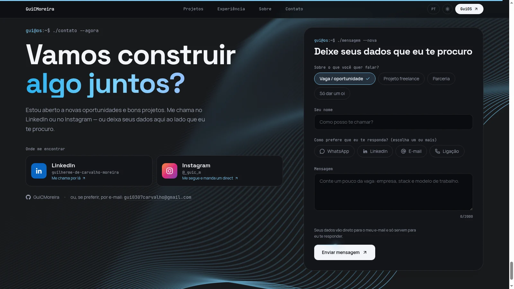 | 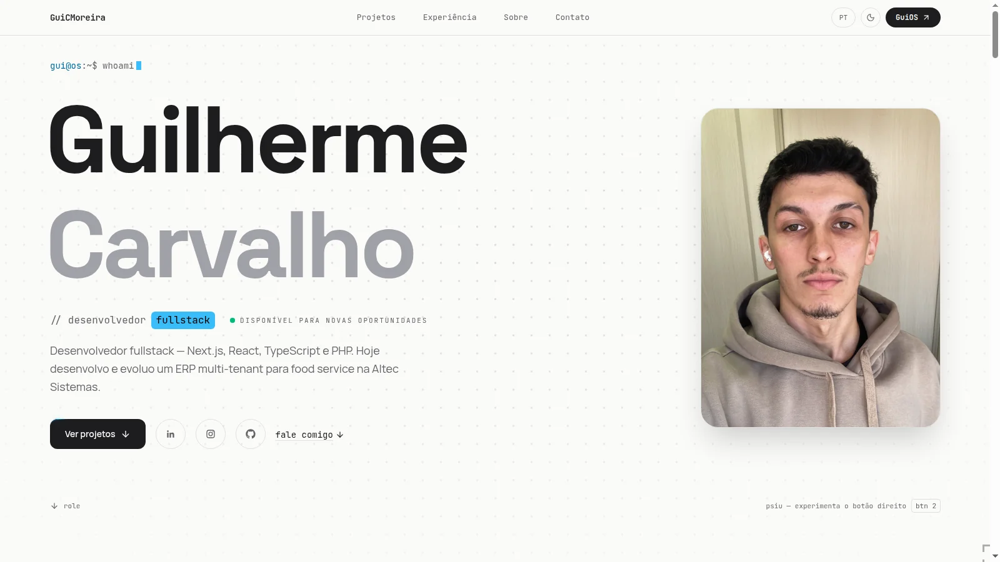 |

**O GuiOS**

| Mesa com o app Sobre                                                                  | Projeto explicado em linguagem simples                                                   |
| ------------------------------------------------------------------------------------- | ---------------------------------------------------------------------------------------- |
| 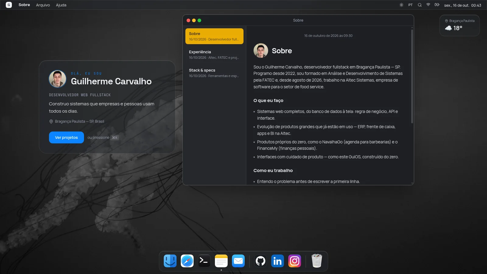 | 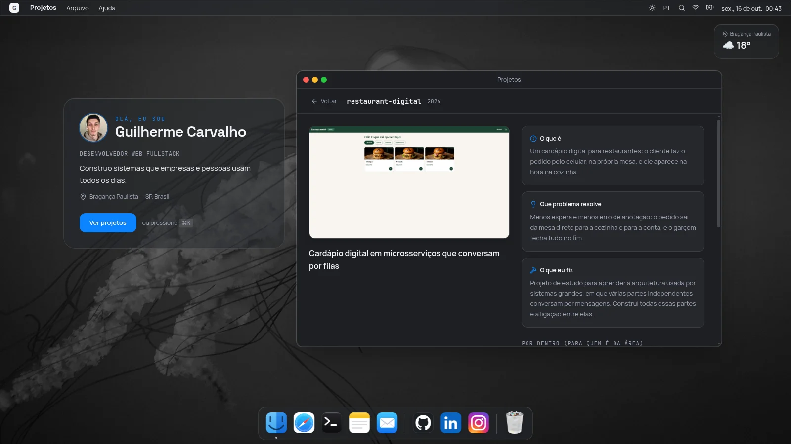 |

| Terminal                                                                     | Laboratório                                                               |
| ---------------------------------------------------------------------------- | ------------------------------------------------------------------------- |
| 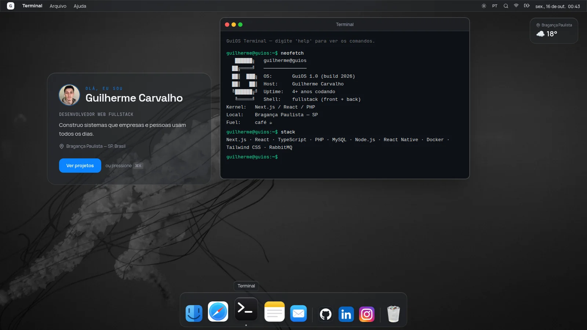 | 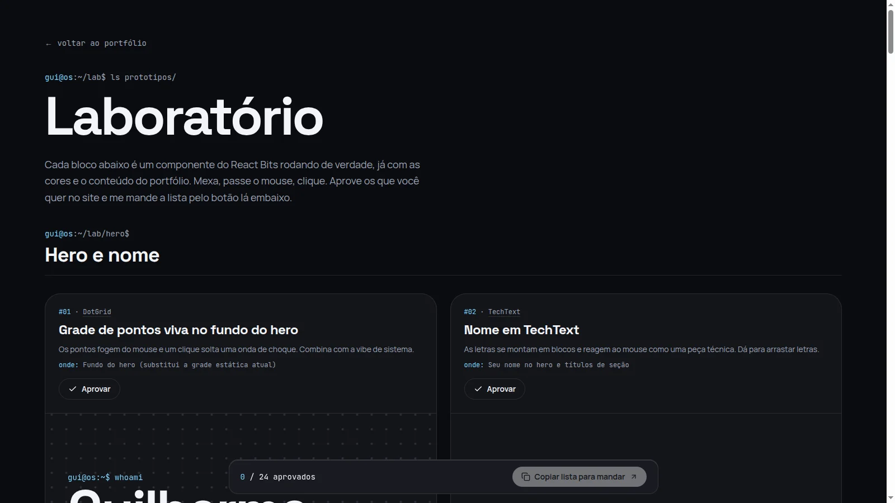 |

**No celular**

<p align="center">
  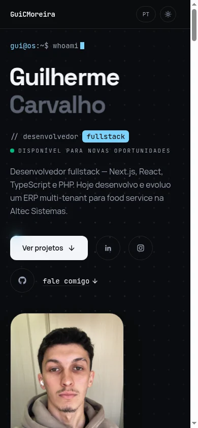
  &nbsp;&nbsp;
  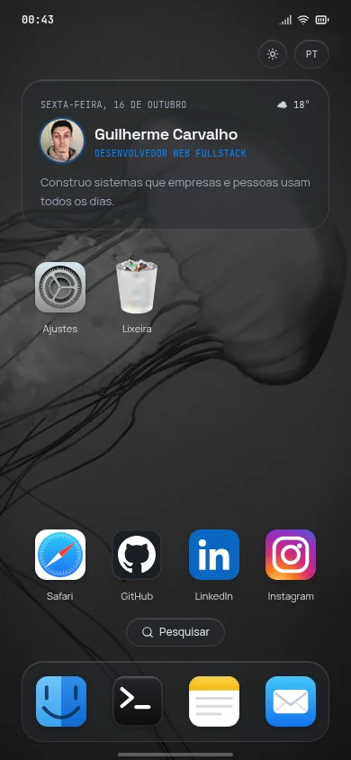
  <br><em>Abaixo de 768px a landing empilha e o GuiOS vira um smartphone, com grade de apps e telas cheias</em>
</p>

As capturas de projetos dentro do site (`public/projects/`) foram feitas em Full HD (1920×1080,
escala 1), com a barra de rolagem escondida e banners de cookie recusados antes do print.

---

## Como funciona

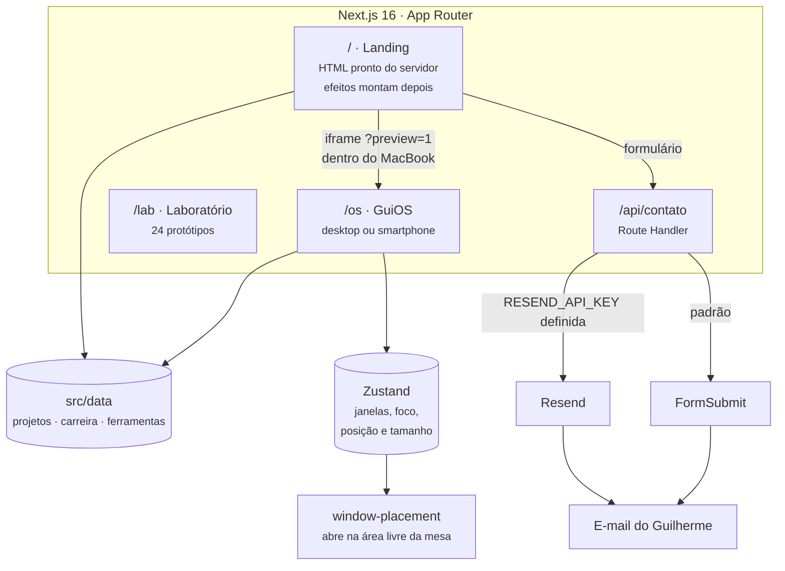

**Um só lugar para o conteúdo.** Projetos, carreira e grupos de ferramentas vivem em `src/data/`
e alimentam a landing e o GuiOS ao mesmo tempo. Cada projeto tem dois textos: o técnico
(`description`, `highlights`) e o simples (`plain`: o que é, que problema resolve, o que o Guilherme
fez). Adicionar um projeto é editar um arquivo; a ordem da vitrine é a constante `ORDER`.

**A landing chega pronta do servidor.** Todo o texto da página está no HTML que o servidor manda
(cerca de 100 KB). Os efeitos visuais — WebGL, canvas, cursor — são componentes só do cliente,
carregados depois e por cima do conteúdo, nunca em volta dele.

**O GuiOS é uma store.** O estado de todas as janelas vive numa única store do Zustand. Dock,
command palette e o comando `open` do terminal só chamam `openApp(id)`; quem decide onde a janela
nasce é `src/lib/window-placement.ts`. Os apps são os mesmos componentes no desktop e no celular;
muda só a moldura.

**O MacBook mostra o GuiOS real.** A seção da landing carrega `/os?preview=1` num iframe lazy,
escalado e não interativo. Não é vídeo nem imagem: é o sistema rodando.

---

## Rodando localmente

```bash
git clone https://github.com/GuiCMoreira/guios.git
cd guios
npm install
npm run dev
```

Abra <http://localhost:3000>. Não precisa de banco. Sem nenhuma variável de ambiente, tudo
funciona; o formulário entrega pelo FormSubmit para o e-mail do Guilherme.

| Variável               | Para quê                                                                              |
| ---------------------- | ------------------------------------------------------------------------------------- |
| `RESEND_API_KEY`       | Entrega o formulário pelo Resend em vez do FormSubmit                                 |
| `CONTACT_TO`           | Para onde vai a mensagem (padrão: o e-mail em `src/data/projects.ts`)                 |
| `CONTACT_FROM`         | Remetente no Resend (padrão: `Portfólio <onboarding@resend.dev>`)                     |
| `NEXT_PUBLIC_SITE_URL` | URL pública, usada em metadata, sitemap e no cabeçalho de origem enviado ao FormSubmit |

```bash
npm run lint       # ESLint
npx tsc --noEmit   # typecheck
npm run build      # build de produção
```

O deploy é na Vercel, a partir da branch `main`. Cada branch empurrada ganha uma prévia própria.

> O FormSubmit pede uma confirmação por e-mail no primeiro envio para um endereço novo. Até ela ser
> clicada, o formulário responde erro.

---

## Decisões que não são óbvias

<details>
<summary><strong>Efeito só do cliente nunca envolve conteúdo</strong></summary>

Na primeira versão da v5, o HTML da landing chegava com 14 KB e quase nenhum texto. O motivo: o
`ClickSpark` (faíscas no clique) era um componente `next/dynamic` com `ssr: false` que envolvia a
página inteira, e um componente que só existe no cliente leva junto tudo o que está dentro dele.
Robôs de busca e quem abre o link num celular lento viam uma página vazia.

A correção virou regra: efeito só do cliente fica **ao lado** do conteúdo, nunca em volta. O
`ClickSpark` ganhou a prop `global` e virou uma camada fixa que escuta cliques na janela. Os outros
efeitos (TechText, DotGrid, Threads) têm um substituto estático que aparece no servidor e enquanto
o canvas carrega (`useReady` em `fx/rb.tsx`). O `<h1>` com "Guilherme Carvalho" está sempre no DOM.

</details>

<details>
<summary><strong>"Reduzir movimento" sem erro de hidratação</strong></summary>

O `useReducedMotion` do Motion devolve `null` no servidor e o valor real no primeiro render do
cliente. Para quem tem "reduzir movimento" ligado, o cliente renderizava uma árvore diferente da do
servidor e o React acusava erro de hidratação — texto diferente, ref sem elemento, atributos
trocados.

`useReducedMotionSafe` usa `useSyncExternalStore` com o snapshot do servidor fixo em `false`: o
primeiro render bate com o HTML e a troca acontece logo depois, como uma atualização normal. Além
disso, os componentes de texto animado (`SplitWords`, `WordReveal`) mantêm **a mesma estrutura de
DOM** nos dois modos — no modo reduzido as palavras continuam em `<span>`, só que paradas. Zero
erros de console nos dois modos.

</details>

<details>
<summary><strong>Janelas que não cobrem a apresentação</strong></summary>

No GuiOS, as janelas nasciam em posições fixas e caíam em cima do cartão "Olá, eu sou Guilherme
Carvalho" e do widget de clima — justamente o que quem chega precisa ver.

`window-placement.ts` mede, no momento de abrir, a camada de janelas e os widgets marcados com
`data-desktop-widget`. A janela vai para a maior área livre, encolhe se a tela for pequena e as
seguintes saem em cascata. Se o usuário arrastou ou redimensionou uma janela, ela ganha
`userPlaced` e passa a abrir onde ele deixou. Medido sem sobreposição em 1920×1080, 1600×900,
1366×768 e 1280×720.

</details>

<details>
<summary><strong>Arrastar e redimensionar sem re-render</strong></summary>

Uma janela que re-renderiza a cada pixel arrastado engasga com o conteúdo pesado dentro dela. A
posição e o tamanho ficam em *motion values* do Motion, atualizados direto no DOM durante o gesto;
o React só fica sabendo quando o gesto termina. A maximização tem os próprios `tx`/`ty`, separados
do arrasto, e mede o alvo no DOM — por isso a janela não treme ao soltar.

</details>

<details>
<summary><strong>Um modal de projeto que nunca rola</strong></summary>

Um modal com rolagem esconde a metade de baixo — e a metade de baixo é onde estão os botões de demo
e GitHub. A partir de 1024px o modal é duas colunas (captura à esquerda, informações à direita) com
proporções que mudam por breakpoint, e um modo compacto para telas baixas
(`[@media(max-height:820px)]`). Verificado sem rolagem para os seis projetos em 1920×1080, 1536×864,
1440×900, 1366×768, 1280×720 e 1024×768. No celular continua empilhado.

Os cards da vitrine têm a mesma altura por construção: imagem em `aspect-video`, linha do ano com
altura fixa e frase reservando duas linhas (`line-clamp-2 min-h-[2lh]`).

</details>

<details>
<summary><strong>Formulário sem banco, sem captcha e sem chave obrigatória</strong></summary>

A validação mora em `src/lib/contact.ts` e roda nos dois lados: o navegador mostra o erro no campo,
o servidor recusa o que vier por fora. O servidor também normaliza o corpo (`sanitizeContact`):
campo desconhecido é descartado, texto é cortado no tamanho máximo, só os canais marcados levam
contato.

Contra robôs, sem captcha: um campo-armadilha (`website`) que humanos não veem e robôs preenchem
— quando vem preenchido, a API responde sucesso e não envia nada — e um limite de 5 envios a cada
10 minutos por IP. A entrega usa o Resend se houver `RESEND_API_KEY` e o FormSubmit caso contrário,
para o site funcionar no primeiro deploy sem configurar nada.

</details>

<details>
<summary><strong>Efeitos testados num laboratório antes de entrar</strong></summary>

Em vez de colocar efeitos direto na landing e ver como fica, os 24 candidatos rodaram lado a lado em
`/lab`, com o conteúdo real. Só os aprovados entraram, e a combinação deles gerou conflitos que um
por um não mostraria: três cursores no mesmo lugar, duas luzes no mesmo card, dois efeitos no mesmo
selo. Cada conflito e a decisão tomada estão na spec da v5.

Os componentes do React Bits ficam copiados em `src/components/rb/` (com a licença ao lado), e a
landing usa adaptadores em `fx/rb.tsx`. WebGL só monta perto da tela; sem WebGL, o fundo fica liso
e o conteúdo aparece normalmente.

</details>

<details>
<summary><strong>Dois textos por projeto</strong></summary>

Recrutador não sabe o que é "multi-tenant com RLS". Dev não quer ler "um sistema que ajuda
barbearias". Cada projeto tem um campo `plain` com três respostas em linguagem simples, mostradas
primeiro no GuiOS, e o texto técnico logo abaixo, sob "Por dentro (para quem é da área)".

</details>

<details>
<summary><strong>Um storage que não quebra</strong></summary>

Tema, idioma e "já viu o boot" ficam no `localStorage` e no `sessionStorage`. Acessar o storage pode
lançar `SecurityError` (cookies bloqueados, iframe em sandbox, modo privado antigo). Todo acesso
passa por `safe-storage.ts`: a leitura devolve `null` e a escrita vira no-op. O site perde a
memória, mas não para de funcionar — o que importa também para o GuiOS dentro do iframe do MacBook.

</details>

<details>
<summary><strong>Fotos e capturas sem metadados</strong></summary>

As fotos do Guilherme foram regravadas em webp a partir dos originais, sem EXIF. As capturas dos
projetos foram feitas em 1920×1080 com escala 1: em resoluções menores os sites usam o layout de
tela pequena e os elementos saem grandes demais no card.

</details>

---

## Testes

Não há suíte automatizada no repositório — e este README não vai fingir que há. A garantia vem de
três lugares:

| O quê                         | Como                                                                                                       |
| ----------------------------- | ---------------------------------------------------------------------------------------------------------- |
| Tipos e padrões               | `npx tsc --noEmit` e `npm run lint` limpos a cada entrega                                                  |
| Qualidade da página           | Lighthouse 100 em desempenho, acessibilidade, boas práticas e SEO, no desktop e no celular                 |
| Comportamento                 | Roteiros de teste de tela escritos antes e executados no navegador (Playwright, com WebGL): os das versões 1 a 4 em [`docs/qa/`](docs/qa/), as medições da v5 em diante na [spec da v5](docs/specs/2026-10-16-landing-v5-combinacao.md) |

Os roteiros cobrem o que costuma quebrar sem ninguém ver:

- zero erros de console com e sem "reduzir movimento"
- HTML do servidor com todo o texto da página
- nenhuma rolagem lateral em 390px
- cards da vitrine com a mesma altura em quatro resoluções
- modal sem rolagem nos seis projetos em seis resoluções
- janelas do GuiOS sem cobrir o cartão nem o clima em quatro resoluções
- formulário: erro por campo, campo-armadilha, limite de envios e entrega real

---

## Estrutura

```
src/
├── app/
│   ├── page.tsx               landing
│   ├── os/                    GuiOS
│   ├── lab/                   laboratório
│   ├── api/contato/           formulário de contato
│   └── …                      layout, metadata, sitemap, robots, manifest, OG image, 404
├── components/
│   ├── landing/               seções, formulário, vitrine do GuiOS
│   │   └── fx/                scroll, cursor, menu do botão direito, adaptadores do React Bits
│   ├── rb/                    componentes do React Bits (com LICENSE.md)
│   ├── lab/                   página do laboratório
│   ├── os/                    desktop: menu bar, dock, janelas, boot, palette, widgets, Ajustes
│   ├── mobile/                moldura de smartphone
│   ├── apps/                  Projetos, Safari, Terminal, Sobre, Contato
│   └── ui/                    ícones
├── data/                      projetos, carreira, ferramentas, apps e lixeira
└── lib/                       store, i18n, tema, contato, posição das janelas, storage seguro
public/
├── projects/                  capturas dos projetos (16:9, webp)
└── me/                        fotos
docs/
├── screenshots/               imagens deste README
├── specs/                     spec de cada rodada da landing
├── qa/                        roteiros de teste de tela
└── superpowers/               design e planos do GuiOS
```

---

## Como foi construído

O projeto começou como o GuiOS puro e foi ganhando a camada de fora em rodadas, cada uma com spec
própria e aprovada numa prévia da Vercel antes de ir para produção.

| Versão | Rodada               | Entrega                                                                                      |
| ------ | -------------------- | -------------------------------------------------------------------------------------------- |
| 1.0    | GuiOS                | Desktop com janelas, dock, terminal, palette, versão de celular, PT/EN                      |
| 2.0    | macOS de verdade     | Tema claro e escuro, menu bar e dock fiéis, ícones estilo Apple, Sobre virou Notes          |
| 2.1    | Safari               | Navegador com histórico e perfil real do GitHub                                             |
| 2.2    | Vida no sistema      | Guigle, lixeira, clima, notificação, menu de contexto, wallpapers, PWA, 404                 |
| 3.0    | Landing híbrida      | Landing em `/`, GuiOS em `/os`, MacBook com o sistema real, onboarding                      |
| 3.1    | Vitrine              | Capturas dos projetos e modal de detalhe                                                    |
| 4.0    | A parte de fora      | Tela inteira, cursor próprio, menu do botão direito, voz de terminal, marquee da stack     |
| 4.1    | Scroll coreografado  | Cada seção rola de um jeito, acento azul, laboratório com 24 protótipos                     |
| 5.0    | Landing v5           | Efeitos aprovados no lab, formulário de contato, vitrine em Full HD, modal sem rolagem      |
| 5.1    | GuiOS para todos     | Capturas e linguagem simples no app Projetos, Sobre detalhado, janelas na área livre        |

O histórico detalhado está no [CHANGELOG](CHANGELOG.md).

---

## Ainda não existe

- Mais de uma imagem por projeto (carrossel no modal e no app Projetos)
- Capturas em Full HD do NavalhaGo e do FinanceMy: os dois ainda não estão publicados, então usam
  as capturas oficiais dos READMEs
- Os próximos projetos da vitrine: e-commerce em PHP e Bico Bot Bar
- Testes automatizados (Playwright no CI) para os roteiros que hoje são executados à mão

---

## Créditos

- Efeitos do laboratório e componentes em `src/components/rb`: [React Bits](https://reactbits.dev)
  (MIT + Commons Clause), de David Haz.
- Ícones da Lixeira, Safari e Ajustes: [WhiteSur icon theme](https://github.com/vinceliuice/WhiteSur-icon-theme)
  (GPL-3), de Vince Liuice.
- Wallpapers: [Lorem Picsum](https://picsum.photos/) (fotos do Unsplash).
- Demais ícones de apps: recriações próprias em SVG.
